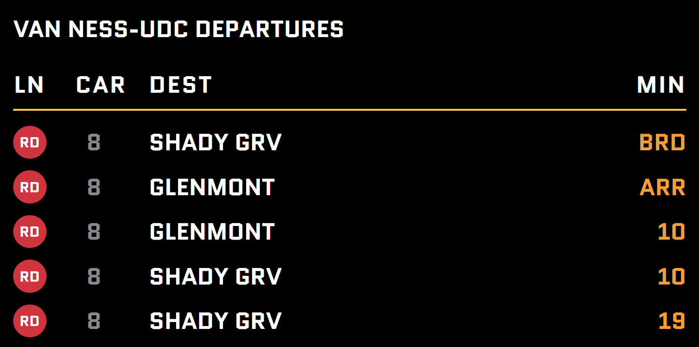

# WMATA Live Train Board

A real-time Washington Metro departure board built with FastAPI. It pulls live train predictions from the WMATA API and displays them in a clean, dark "station display" style, similar like the boards you see on the platform.



## Features

- Live train predictions for any WMATA station (configurable via environment variable)
- Station-style display showing **Line**, **Car count**, **Destination**, and **Minutes**
- Special `ARR` (arriving) and `BRD` (boarding) statuses
- Filters out "ghost" trains (entries with no line assigned)
- Shows the next 5 departures
- Auto-refreshes every 20 seconds

- **Backend:** Python 3.11, FastAPI, Uvicorn
- **HTTP client:** httpx (async)
- **Templating:** Jinja2
- **Config:** python-dotenv, pydantic-settings
- **Frontend:** HTML, CSS, Google Fonts (Quantico)
- **Data source:** [WMATA Developer API](https://developer.wmata.com/)

## Project Structure

```
Metro_Train_Schedules/
├── app/
│   ├── static/
│   │   ├── css/style.css         # Board styling
│   │   └── js/main.js            # Frontend scripts
│   ├── templates/
│   │   └── index.html            # Departure board template
│   ├── __init__.py
│   ├── config.py                 # Settings loaded from environment
│   └── main.py                   # FastAPI app and routes
├── img/
│   └── Live_Train_Schedule.png
├── .env.example                  # Example environment variables
├── .gitignore
├── requirements.txt
└── README.md
```

## Getting Started

### Prerequisites

- Python 3.11+
- A free WMATA API key from the [WMATA Developer Portal](https://developer.wmata.com/)

### Installation

1. **Clone the repository**

   ```bash
   git clone <your-repo-url>

   cd Metro_Train_Schedules
   ```

2. **Create and activate a virtual environment**

   ```bash
   python -m venv venv

   # Windows (PowerShell)
   .\venv\Scripts\Activate.ps1

   # macOS / Linux
   source venv/bin/activate
   ```

3. **Install dependencies**

   ```bash
   pip install -r requirements.txt
   ```

4. **Configure environment variables**

   Copy the example file and add your API key:

   ```bash
   cp .env.example .env
   ```

   Then edit `.env`:

   ```env
   WMATA_API_KEY=your_api_key_here

   STATION_CODE=A06
   ```

   | Variable        | Description                                                  | Default  |
   | --------------- | ------------------------------------------------------------ | -------- |
   | `WMATA_API_KEY` | Your WMATA API primary key                                   | *(none)* |
   | `STATION_CODE`  | WMATA station code (`A06` = Van Ness-UDC)                    | `A06`    |

   Find other station codes in the [WMATA Stations API](https://developer.wmata.com/docs/services/5476364f031f590f38092507/operations/5476364f031f5909e4fe3311).

### Run the App

```bash
python -m app.main
```

Or run Uvicorn directly:

```bash
uvicorn app.main:app --host 127.0.0.1 --port 5000 --reload
```

Then open [http://127.0.0.1:5000](http://127.0.0.1:5000) in your browser.

## How It Works

1. A request to `/` triggers an async call to WMATA's `StationPrediction` endpoint for the configured station.
2. Trains with no line assigned (`Line: "No"`) are filtered out and the first 5 remaining are kept.
3. The station name is read from the API response.
4. Jinja2 renders `index.html` with the train data (or an error message if the API call fails).
5. A `<meta http-equiv="refresh">` tag reloads the page every 20 seconds to keep times current.

## Acknowledgments

- Train data provided by [WMATA](https://developer.wmata.com/)
- Font: [Quantico](https://fonts.google.com/specimen/Quantico) via Google Fonts